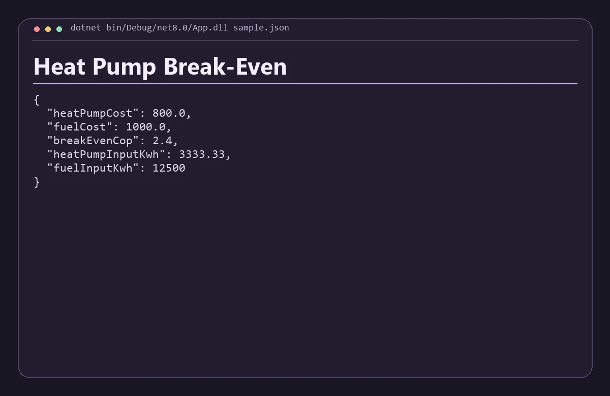

# Heat Pump Break-Even

Compare scenario heating costs and find the heat-pump efficiency needed to match an alternative heating source.



## Run

Install .NET 8 SDK and runtime. Run these commands from the repository root.

```sh
dotnet build --nologo
dotnet bin/Debug/net8.0/App.dll sample.json
```

Replace `sample.json` with a JSON file following the same structure. The app prints a JSON report to standard output.

Enter prices in one consistent currency per kWh of purchased energy. COP is delivered thermal energy divided by purchased electricity. Fuel efficiency is a fraction from zero to one. The comparison excludes equipment, maintenance, and changing rates.

## Verify

Run `python check.py` with Python 3.11 or newer after the build step when applicable. The check verifies the bundled scenario and confirms that an invalid input returns an error.
